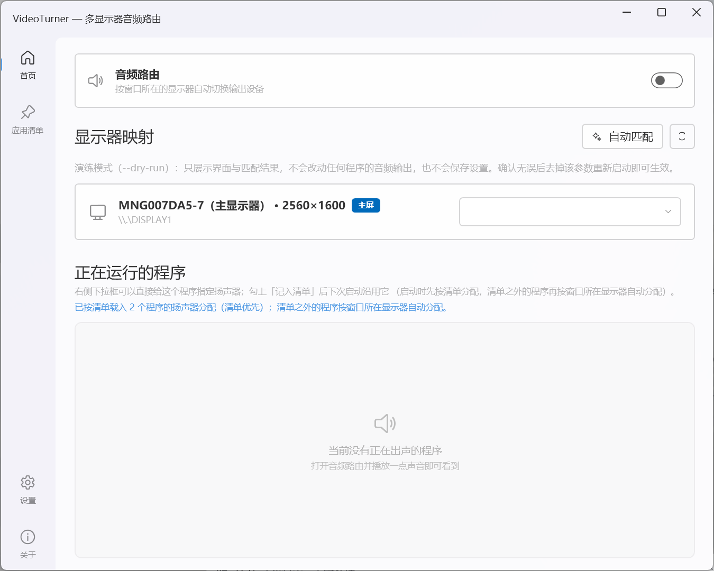

# VideoTurner

**窗口在哪台显示器上，声音就从那台显示器对应的音频设备里出来。**

Windows 的多显示器音频路由小工具：常驻托盘，按「显示器 → 音频设备」的映射，自动把每个程序的声音
送到它窗口所在那台屏对应的音箱 / 耳机。每个正在运行的程序也能单独指定一台扬声器，并决定要不要
把它记进**应用清单** —— 下次启动先按清单分配，清单之外的程序再按显示器自动分配。

界面全中文，按用户安装，不弹 UAC，不需要管理员权限，不需要驱动。
基于 MIT 许可的开源项目 [ScreenSound](https://github.com/twibster/ScreenSound) 改写。

[](LICENSE)
[](#系统要求)
[](https://dotnet.microsoft.com/download/dotnet/8.0)
[](https://github.com/swblueice/VideoTurner/releases)

<!-- 截图：把界面截图放到 docs/images/ 下，路径对应修改 -->


---

## 目录

- [为什么需要它](#为什么需要它)
- [下载与安装](#下载与安装)
- [快速开始](#快速开始)
- [功能](#功能)
- [自动匹配是怎么做到的](#自动匹配是怎么做到的)
- [按应用分配扬声器 / 应用清单](#按应用分配扬声器--应用清单)
- [虚拟通道模式](#虚拟通道模式)
- [已知限制](#已知限制)
- [路由没生效？按这个顺序查](#路由没生效按这个顺序查)
- [从源码构建](#从源码构建)
- [仓库结构](#仓库结构)
- [系统要求](#系统要求)
- [参与贡献](#参与贡献)
- [致谢与许可](#致谢与许可)

---

## 为什么需要它

Windows 没有原生的「按显示器路由音频」。插了副屏或电视之后，要么所有程序都从系统默认设备出声，
要么在音量合成器里一个个手动选 —— 而且程序一关，选择就没了。

VideoTurner 做三件事：

1. 记住「哪台显示器对应哪台音频设备」，程序出现在哪台屏上就把它的声音送到那台屏；
2. 允许给单个程序钉死一台扬声器（比如「游戏永远走耳机」），并持久化；
3. 处理那些**只在启动时读一次输出设备**的程序（游戏、模拟器客户端），
   用进程级虚拟通道让出口跟着窗口走，不用重启程序。

## 下载与安装

到 [Releases](https://github.com/swblueice/VideoTurner/releases/latest) 下载：

| 文件 | 说明 |
|---|---|
| `VideoTurner-<版本>-win-x64-setup.exe` | 安装版。按用户安装到 `%LOCALAPPDATA%\Programs\VideoTurner`，**不弹 UAC**，带卸载程序 |
| `VideoTurner-<版本>-win-x64-portable.zip` | 便携版。解压即用，不需要安装、不需要预装 .NET（运行时已打包） |

两个包都是 **自包含** 的，目标机器不需要预装 .NET 8 桌面运行时。旁边附 `.sha256.txt` 可核对。

> 程序没有代码签名证书，首次运行 Windows SmartScreen 会提示「未知发布者」，
> 点「更多信息 → 仍要运行」即可。校验哈希是更靠谱的做法。

安装包行为：

| 项目 | 说明 |
|---|---|
| 安装位置 | `%LOCALAPPDATA%\Programs\VideoTurner`（按用户安装，全程不弹 UAC） |
| 需要管理员？ | 不需要（只有「要接管以管理员身份运行的程序」时才需要提权启动本程序） |
| 快捷方式 | 开始菜单 → `VideoTurner`；可选桌面图标（安装时勾选） |
| 开机自启 | **安装器不写**，由程序设置页的开关管理（写 `HKCU\...\Run`），卸载时会清掉 |
| 升级安装 | 同一个 `AppId`，再装一次即覆盖；安装前会自动结束正在运行的实例 |
| 卸载 | 开始菜单「卸载 VideoTurner」；会问是否连 `%APPDATA%\VideoTurner` 的设置/日志一起删 |
| 静默安装 | `setup.exe /VERYSILENT /SUPPRESSMSGBOXES` |
| 静默卸载 | `unins000.exe /VERYSILENT /SUPPRESSMSGBOXES`（加 `/DELETEUSERDATA=1` 连用户数据一起清） |

## 快速开始

1. 启动 VideoTurner。首页会列出当前的显示器与音频设备。
2. 每台显示器右边选一台音频设备（HDMI / DisplayPort 屏通常会**自动**选中对应声卡，见下一节），
   选完的映射标为「手动」，自动匹配不会再覆盖它。
3. 拖一个正在放声音的程序窗口到副屏 —— 它的声音会跟着搬过去（粒度是进程，见[已知限制](#已知限制)）。

**先演练一遍**：`VideoTurner.exe --dry-run` 只开界面、不动任何音频、不写设置文件，
用来确认映射关系是否符合预期。不确定就先用它。

设置文件 `%APPDATA%\VideoTurner\settings.json`（映射、开关、应用清单都在这里，可手工编辑），
日志 `%APPDATA%\VideoTurner\routing.log`（每次路由循环与每个决策一行，超过 1 MB 自动轮转）。

## 功能

| 能力 | 说明 |
|---|---|
| **中文界面** | 首页、应用清单、设置、关于四页全部中文化；托盘菜单也中文化 |
| **按显示器自动匹配音频端点** | 两层依据：设备容器 ID（最可靠）+ 端点名称里的显示器型号，见下一节 |
| **手动覆盖永远优先** | 下拉框改过的映射标记为「手动」，自动匹配不会再覆盖；自动匹配来的映射带「自动」徽章 |
| **按应用分配扬声器 + 应用清单** | 每个运行中的程序都能单独选一台扬声器，勾「记入清单」后下次启动沿用；启动顺序是**先清单、再自动** |
| **虚拟通道（进程级，无驱动）** | 程序先落到静音虚拟声卡，再按窗口所在显示器把每路音频送到真正的设备 —— 治「只在启动时读一次输出设备」，拖窗口不用重启程序 |
| **托盘常驻** | 关闭窗口默认只是收进托盘（可在设置里改）；托盘菜单可开关路由、触发自动匹配、退出 |
| **开机自启** | 设置页开关，写当前用户启动项（HKCU），不需要管理员 |
| **`--dry-run` 演练模式** | 只开界面、不动音频、不写设置 |
| **黑匣子 + 诊断** | 首页状态行 + `routing.log` + 设置页「运行自检 / 依次试听各设备 / 打开日志」 |
| **一键安装包** | `tools/make-installer.ps1` → 自包含 + Inno Setup 的中文安装包 |

> ⚠️ 音频路由依赖 Windows 未公开的 `AudioPolicyConfig` 接口（与上游同源），
> 属于「能用但官方不保证」。粒度是**进程 / 音频会话，不是窗口** —— 详见[已知限制](#已知限制)。

## 自动匹配是怎么做到的

「显示器型号 → 音频端点」有两层依据，从强到弱。

### 第一层：设备容器 ID（最可靠）

Windows 内部有一张「音频端点 ↔ 显示器」的配对关系，就藏在设备容器里：

- 显示器：CCD（`QueryDisplayConfig`）给出设备接口路径
  `\\?\DISPLAY#<厂商码><产品码>#<实例>#{…}`，拿它回查
  `HKLM\SYSTEM\CurrentControlSet\Enum\DISPLAY\…` 得到 `ContainerID`
- 音频端点：`PKEY_Device_ContainerId`
  （`HKLM\SOFTWARE\Microsoft\Windows\CurrentVersion\MMDevices\Audio\Render\{endpoint}\Properties`）

**HDMI / DisplayPort 端点的容器 ID 与它当前所连显示器的 `ContainerID` 完全相同**，
所以这一层几乎是确定性的：

```
HDMI (NVIDIA High Definition Audio)   容器 5a8b…  →  \\.\DISPLAY2（副屏）   [自动]
扬声器 (板载声卡)                     容器（空容器）  →  不参与匹配
扬声器 (第三方虚拟声卡)                容器（空容器）  →  不参与匹配
```

> 坑位：内部声卡、虚拟声卡、以及部分内置屏在注册表里的容器都是
> `00000000-0000-0000-ffff-ffffffffffff`（「空容器」）。这个值必须**当作无效**丢弃 ——
> 否则会把虚拟声卡错配给主屏。代码里专门过滤它（`Services/DeviceContainerService.cs`）。

### 第二层：端点名称里的型号

部分机器（尤其 AMD / Intel 显卡）会把显示器型号直接写进端点名，例如
`AMD High Definition Audio Device — 3 - <显示器型号>`。做法是把显示器型号切成
「含数字、长度 ≥ 3」的令牌，再去归一化后的端点名里找包含关系。

### 匹配不到就不猜

两层都不命中时，那台显示器保持**未映射**（跟随系统默认设备），界面上提示手动选择。
宁可漏配，也不把声音切到错的设备上。

### 显示器型号从哪来

`EnumDisplayDevices` 在很多机器上只返回「Generic PnP Monitor」，
所以型号名改从 **CCD（`QueryDisplayConfig` → `DISPLAYCONFIG_TARGET_DEVICE_NAME`）** 取，
也就是 Windows 显示设置里显示的那个名字；取不到再退回 EDID 解析（tag `0xFC` 描述符）。

想先看自己机器上的匹配结果，用只读探针（不开界面、不改任何东西）：

```powershell
dotnet run --project tools/MatcherProbe
```

```
\\.\DISPLAY1  <内置屏型号>   主屏   容器（空）        → 不自动映射（走系统默认）
\\.\DISPLAY2  HDMI          副屏   容器 5a8b…       → HDMI (NVIDIA High Definition Audio)   [自动]
```

## 按应用分配扬声器 / 应用清单

三层决策，优先级从高到低：

```
① 应用清单：这个程序被分配了某台扬声器 → 窗口拖到哪台屏都从这台出声
② 自动分配：清单里没有 → 按窗口所在显示器的映射
③ 系统默认：连映射都没有 → 不动它，跟随系统默认设备
```

启动时也是这个顺序：**先按清单分配，清单之外的程序再自动分配**。

两个入口，效果一样：

1. **首页 →「正在运行的程序」** 每行右侧有扬声器下拉框：
   - 选一台设备 = 立即给这个程序分配（下一次路由周期生效，通常 < 200 ms）；
   - 选「自动 · 按窗口所在显示器」= 取消分配，交还给显示器映射；
   - 旁边「记入清单」勾选框决定这条分配**要不要保存**：勾上写进 `settings.json`，下次启动沿用。
     首次给某个程序选设备时会自动勾上。
2. **应用清单页**：可以给没在出声的程序提前分配；已有条目可直接改设备、勾/取消、删除。

几个刻意的设计：

- **记入清单 ≠ 立刻生效**：不勾清单的分配照样当场生效，只是不落盘。
- **设备拔掉不死等**：清单里指定的设备此刻不在（关了 HDMI 屏、拔了 USB 声卡）时，
  引擎**回落到显示器映射 / 系统默认**并写进日志；设备接回来自动切回去，清单条目本身不丢。
- **能在出声之前就生效**：有一个每秒扫一次的看门狗，进程一出现（还没创建音频流）就把策略设好 ——
  这是治「只在启动时读一次输出设备」的关键。
- **粒度是进程**：按进程名（不含 `.exe`、忽略大小写）生效，同一程序的所有实例共用一条。

## 虚拟通道模式

> 解决的问题：有的程序（游戏、模拟器客户端、部分播放器）**只在启动时读一次输出设备**，
> 之后改系统策略也不会搬 —— 窗口拖到副屏，声音还留在原来的设备上。重启它能好，但每次都重启不能接受。

做法是**不让程序换设备，让出口跟着窗口换**：

```
程序 → 静音虚拟声卡（端点 ID 永久稳定，程序只读这一次）
     → 按进程回环捕获 → 按窗口所在显示器送到真正的设备
```

- 程序第一次被纳入时**重启一次**，之后它每次启动都落在虚拟声卡上；拖窗口只换下游出口，程序无感。
- 每个程序**一条独立通道**（进程回环捕获，Windows 10 2004+），互不干扰。
- 目标解析：按应用固定 > 窗口所在显示器映射 > 系统默认设备。

### 用之前需要一台虚拟声卡

程序按**名称**识别虚拟输出端点（`CABLE` / `VOICEMEETER` / `VIRTUAL AUDIO` / `VB-AUDIO`）。
最省事的是装 [VB-Cable](https://vb-audio.com/Cable/)，它默认就是静音输出端点。
仓库里带了一键脚本（从 VB-Audio 官方地址下载它自己的安装包，**不捆绑任何第三方二进制**）：

```powershell
powershell -ExecutionPolicy Bypass -File tools/install-virtual-cable.ps1
```

装好之后：设置页 →「虚拟通道」→ 打开开关、选中 `CABLE Input`（可「重新扫描」）→
点「纳入当前正在出声的程序」→ **重启那个程序一次** → 之后随便拖窗口。

> ⚠️ 退出本程序时会把托管程序在虚拟声卡上的固定项还原 —— 否则它没在跑的时候，
> 那些程序会把声音送进静音端点，等于全哑。想「永不还原」就一直常驻（配合开机自启）。

实测结论（完整数据见 [`docs/虚拟通道-设计与验证.md`](docs/虚拟通道-设计与验证.md)）：
改一个正在出声的进程的设备成功；不重启它也能把音频抓下来送到另一台设备；
同一个 exe 的新实例一启动就落在虚拟声卡上（策略按可执行文件持久化）。

边界：

- **必须有虚拟声卡**；没有时虚拟模式不生效，直连模式照旧可用。
- 关掉「音频路由」开关时，**已建立的虚拟通道会继续工作**（送到上一次的目标）——
  那些程序已经落在虚拟声卡上，停掉捕获就等于静音。想真正回直连：先关虚拟通道，再重启那些程序。
- 换一台虚拟声卡需要重新走一遍「重启一次」。
- 延迟约 0.2–0.3 s（捕获 20 ms + 缓冲 200 ms + 端点 100 ms），听音乐看视频可以，音游不行。
- 受保护内容（DRM）可能不允许回环捕获。
- 自研虚拟声卡驱动（`SysVAD` 派生）是下一步，本仓库尚未包含。

## 已知限制

1. **粒度是进程，不是窗口。** Windows 没有原生的「按显示器路由音频」，本程序走的是未公开的
   `Windows.Media.Internal.AudioPolicyConfig.SetPersistedDefaultAudioEndpoint(pid, …)`，
   效果等价于在音量合成器里给某个程序选输出设备。同一个程序开多个窗口分放在两台屏上时，
   声音无法再细分，会跟随它「主窗口 / 焦点窗口」所在的那台屏。
   真要按窗口，只能在该程序内部用 `HTMLMediaElement.setSinkId()` 自己实现。
2. **未公开接口有翻车风险。** Windows 大版本更新可能改动它，届时需要适配。
3. **只处理正在出声的程序。** 没在播放音频的进程不会出现在「正在运行的程序」里（Windows 的会话机制如此）。
4. 进程识别走「进程名（不含 `.exe`，忽略大小写）」，同一个 exe 的多实例共用一条规则。
5. 首次正常运行会立刻按映射改音频路由；不确定时先用 `--dry-run`。
6. **最小化的播放器窗口可能被认错显示器（继承自上游的缺陷）。**
   窗口最小化后矩形会变得极小或跑到屏幕外，`MonitorService.FindMainWindowForProcess` 会把它丢掉，
   于是路由可能回落到系统默认设备或该程序的另一个窗口（例如桌面歌词）。
   上游有一个**尚未合并**的修复 PR（"Keep the assigned monitor when a player is minimized or hidden"），
   本项目尚未移植 —— 欢迎 PR。
7. **有些程序只在启动时读一次输出设备。** 这类程序启动后就把音频设备固定住了，运行中改策略
   **不会迁移它已经在播的声音流**。两种应对：
   - **重启那个程序**（最直接）；
   - **在首页给它分配扬声器并勾「记入清单」**：清单里的程序由看门狗在进程一启动（还没出声）时
     就把策略设好，以后不用再重启。
   程序会自动识别这种情况并在首页状态行写明
   （对比「该会话实际播放的设备」与「目标设备」，不一致就提示）。
8. **清单分配是按进程名（exe）算的，不是按窗口。** 与限制 1 是同一件事。

## 路由没生效？按这个顺序查

程序装了「黑匣子」：**首页那行灰色状态**是最近一次路由结果，完整决策链在
`%APPDATA%\VideoTurner\routing.log`。设置页 →「诊断」有三个按钮：

1. **点「运行自检」** —— 它会真的调一次未公开接口（只作用于本程序自身并立即清除），
   然后列出接口激活结果、可见设备、显示器映射、活动会话、最近一次路由状态，整段可复制。
   - 出现 `0x80070005`（拒绝访问）→ 当前进程上下文被系统拒绝（沙箱 / AppContainer / 受限令牌）。
     这不是程序缺陷：从桌面快捷方式正常双击启动即可。
   - 自检成功 → 接口没问题，继续看首页状态行。
2. **读首页状态行的措辞**，它直接写明引擎做了什么：
   - `QQMusic → HDMI (NVIDIA High Definition Audio)（显示器映射）✅` = 路由成功。
   - `QQMusic → 耳机（清单分配）✅` = 命中了应用清单里的分配。
   - `… ❌ HRESULT 0x…` = 调用被拒，原因就在这行。
   - `… 不路由：找不到该进程的可见窗口` = 窗口识别失败（最小化的播放器属于这类）。
   - `… 不路由：窗口在 X，该显示器没有映射` = 该屏还没配设备。
3. **点「依次试听各设备」** —— 依次在每台设备上播一声提示音，**听哪台不响**。
   如果映射指的那台设备本身没有喇叭（无扬声器的 HDMI 屏、采集卡、虚拟屏），
   路由再正确也听不见 —— 换个真能出声的设备，或干脆不映射让它跟随系统默认。
4. 仍不确定，把「自检报告」和 `routing.log` 一起贴到 issue 里。

> 为什么需要第 3 步：程序只负责把声音**搬到**某台设备，那台设备有没有喇叭它管不了；
> 而「声音被搬走了所以听不见」与「根本没生效还是原来那台在响」的主观感受是一样的，
> 只有试听能把两者分开。

## 从源码构建

需要 **.NET SDK 8 或更高**（本项目用 `net8.0-windows` 目标；用 .NET 10 SDK 也能构建）。

```powershell
git clone https://github.com/swblueice/VideoTurner.git
cd VideoTurner

# 构建
dotnet build src/VideoTurner/VideoTurner.csproj -c Release

# 演练模式：只开界面，不动音频、不写设置
src/VideoTurner/bin/Release/net8.0-windows/VideoTurner.exe --dry-run
```

依赖：`CommunityToolkit.Mvvm`、`NAudio`、`System.Drawing.Common`、`WPF-UI`（全部 MIT，见
[THIRD-PARTY-NOTICES.md](THIRD-PARTY-NOTICES.md)）。

> 离线 / 受限网络构建：如果 `dotnet restore` 因为 TLS（`SEC_E_NO_CREDENTIALS`）或代理失败，
> 把 `.nupkg` 预先下到本地目录，再用一个本地源配置文件还原：
> `dotnet restore --configfile NuGet.offline.config`。

### 打包

```powershell
# 安装包（自包含发布 + Inno Setup 编译，产物在 dist\installer\）
powershell -ExecutionPolicy Bypass -File tools/make-installer.ps1

# 便携版 zip（产物在 dist\portable\）
powershell -ExecutionPolicy Bypass -File tools/make-portable-zip.ps1
```

`make-installer.ps1` 需要 [Inno Setup 6](https://jrsoftware.org/isdl.php) 的 `ISCC.exe`：
脚本自动在 `PATH`、`%ProgramFiles(x86)%\Inno Setup 6`、`tools\InnoSetup6\` 里找，
也可以用 `-Iscc <路径>` 指定。加 `-ToDesktop` 会顺手复制一份到桌面（含 `.sha256.txt`）。

> `installer/VideoTurner.iss` 必须存成 **UTF-8 带 BOM**，否则编译器按 ANSI 读、中文界面文案乱码；
> 构建脚本每次都会自动补。

## 仓库结构

```
VideoTurner/
├── src/VideoTurner/                 ← 程序本体（C# / .NET 8 / WPF）
│   ├── Interop/                     ← Win32 / COM：AudioPolicyConfig、CCD、WASAPI、WinEvent
│   ├── Services/                    ← 路由引擎、端点服务、自动匹配、虚拟通道、日志
│   ├── ViewModels/  Views/          ← MVVM 界面
│   └── Models/                      ← 设置、设备、会话、显示器数据模型
├── installer/                       ← Inno Setup 脚本与中文语言文件
├── tools/
│   ├── MatcherProbe/                ← 只读探针：打印显示器 / 音频端点 / 自动匹配结果
│   ├── LoopbackProbe/               ← 只读探针：验证「进程回环捕获 → 渲染到另一台设备」
│   ├── ApiProbe/                    ← 只读探针：未公开接口可用性探测
│   ├── make-installer.ps1           ← 一键构建安装包
│   ├── make-portable-zip.ps1        ← 一键打便携版 zip
│   ├── install-virtual-cable.ps1    ← 一键装 VB-Cable（虚拟通道需要）
│   └── dump-windows.ps1             ← 打印某进程的窗口 / 显示器归属
├── docs/
│   ├── 虚拟通道-设计与验证.md        ← 虚拟通道架构、实测数据、边界
│   └── images/                      ← 界面截图
└── .github/workflows/               ← CI：构建 + 打包 + 发布 Release
```

相对上游新增的关键文件：

- `Interop/DisplayConfig.cs` —— 显示器拓扑（CCD）查询，拿**显示器型号名**与设备路径
- `Services/DeviceContainerService.cs` —— 从注册表读显示器 / 音频端点的容器 ID、解析 EDID 名称
- `Services/AudioEndpointMatcher.cs` —— 自动匹配规则
- `Services/VirtualChannelEngine.cs` —— 虚拟通道路由
- `Services/AppInfoService.cs` —— 版本号 / 版权行（取代上游的联网更新检查）

## 系统要求

- Windows 10 1809（17763）或更高，Windows 11 全部版本；x64
- 虚拟通道模式需要 Windows 10 2004+（进程回环捕获），以及一台虚拟声卡（如 VB-Cable）
- 运行安装版 / 便携版**不需要**预装 .NET；从源码构建需要 .NET SDK 8+

## 参与贡献

欢迎 issue 与 PR。提问前先看[已知限制](#已知限制)与[排错顺序](#路由没生效按这个顺序查)；
报 bug 请附上「自检报告」与 `routing.log` 的相关片段（发之前把里面的用户名、设备名过一遍）。
细节见 [CONTRIBUTING.md](CONTRIBUTING.md)。

## 致谢与许可

本项目以 **MIT** 许可发布，见 [LICENSE](LICENSE)。

它派生自 [ScreenSound](https://github.com/twibster/ScreenSound)（MIT，Copyright © 2026 Omar Omran），
按 MIT 要求保留了原版权与许可声明：见
[`LICENSE-ScreenSound-MIT.txt`](LICENSE-ScreenSound-MIT.txt)、
`VideoTurner.csproj` 的 `<Copyright>` 与安装包许可页。
其余第三方组件的许可列在 [THIRD-PARTY-NOTICES.md](THIRD-PARTY-NOTICES.md)。
